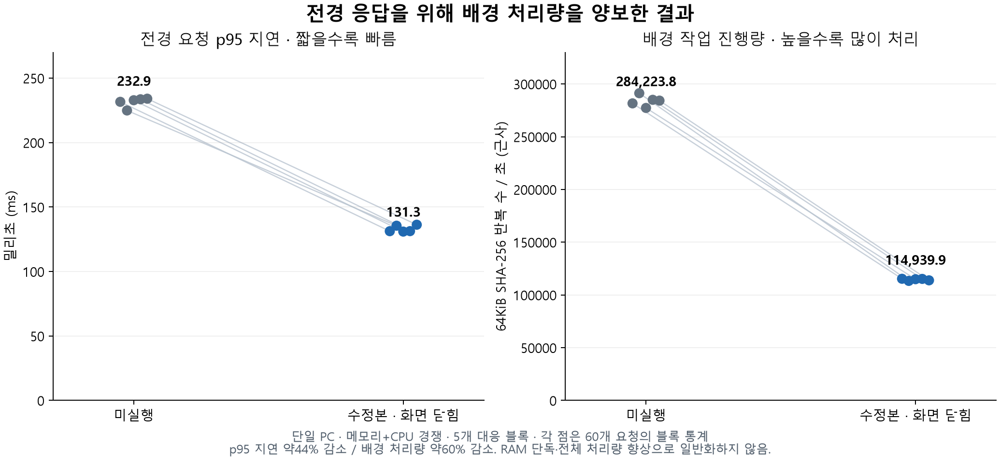

# 배경 자원 제어 수정과 실제 비교 — 2026-11-09

**이 PC의 통제된 메모리·CPU 동시 압박 작업에서는 수정본의 전경 요청 p95 지연이 약 43.6% 줄었습니다. 배경 작업 처리량은 약 59.6% 감소했습니다.** 전경 작업을 위해 지정한 배경 작업이 자원을 양보한 결과입니다. PC 전체 성능이나 RAM 단독 효과를 같은 비율로 개선했다는 뜻은 아닙니다.

## 구현한 변경

1. **명시적 배경 작업 제어:** 실행 파일 전체 경로를 지정한 작업은 자원 압박 시 30분을 기다리지 않고 CPU Below Normal·Memory Priority 3·선택된 EcoQoS를 적용합니다. CPU 진입/해제는 80%/60% 히스테리시스를 씁니다. 전경·같은 이름의 전경 앱·시스템·보호 목록·활동 미확인·PID 신원 보호를 유지하고, 지정은 바쁜 앱의 강제 Working Set 정리 권한을 부여하지 않습니다. 전경 전환·관리 중지·수요 완화 등에 원복합니다.
2. **메모리 기준 작업 큐:** 사용자가 실행 파일·인수 배열·예상 메모리를 지정해 제출합니다. 기본 동시 실행 1개(1–16), 기본 여유 1024MiB, 예상 작업 메모리와 Commit 85% 기준을 적용합니다. 아직 실제 할당하지 않은 실행 중 작업의 메모리도 예약합니다. 대기 취소만 지원하고, 관리 종료로 실행 중인 일을 죽이지 않습니다. 추정량은 강제 할당 한도가 아니며 임의 외부 앱 캐시를 지우지 않습니다. 대기열의 작업을 재시작 시 자동 재실행하지 않습니다.
3. **가벼운 트레이 상주:** 화면 X는 준비 확인을 거쳐 별도 WinForms 트레이로 넘긴 뒤 WPF를 종료합니다. 엔진과 작업은 유지되고 재열기 시 기존 관리 설정을 유지합니다. 새 엔진은 Dry Run이며, 트레이 전환 실패 시 기존 UI를 유지합니다.

## 성능 결과

블록별 60개 요청의 p50/p95를 먼저 계산하고, 아래는 **5개 대응 블록의 중앙값**입니다. 300개 요청을 독립된 300회 실험으로 취급하지 않았습니다.

| 부하 / 비교 | 기준 p50 | 수정 p50 | 기준 p95 | 수정 p95 | p95 감소 | 배경 초당 처리량 감소 |
| --- | ---: | ---: | ---: | ---: | ---: | ---: |
| 메모리+CPU 경쟁 · 미실행 vs 수정 엔진+트레이 | 223.60ms | 129.01ms | 232.85ms | 131.32ms | 43.6% | 59.6% |
| CPU 경쟁 · 이전 엔진 vs 수정 엔진 | 227.62ms | 128.99ms | 230.78ms | 219.76ms | 4.8% | 38.4% |

메모리+CPU 비교에서 블록별 p95 감소는 43.32%, 39.74%, 43.76%, 43.78%, 41.77%로 **5회 모두 감소**했습니다. p95 범위는 미실행 224.89–234.05ms, 수정본 130.97–136.28ms였습니다. CPU 경쟁만 있는 조건의 느린 상위 요청 개선은 작았습니다. 이 차이도 제외하지 않았습니다.

## 동일 부하와 실제 동작 확인

- Windows 11 Pro 26200, i5-13400, 16 논리 스레드, 물리 RAM 약23.68GiB인 단일 PC에서 비교했습니다. .NET10 런타임을 사용했습니다.
- 실제 Win32 전경 창의 프로세스에서 미리 채운 **256MiB 버퍼의 SHA-256 요청**을 수행했습니다. 주 지표는 명령 전송→응답 수신 시간입니다. 윈도 메시지 입력 지연, 프레임 렌더링, IDE 편집 작업, 게임 FPS를 측정한 것은 아닙니다.
- 배경 부하는 동일한 자체 프로세스 8개, 각 2개 스레드·64MiB 데이터입니다. 쌍 안에서 같은 전경·배경 PID와 같은 외부 메모리 할당량을 유지했습니다. 조건 순서는 난수 시드20261111로 섞었습니다. 프로그램의 메모리 비용을 맞추려고 조건별 외부 부하를 다시 조절하지 않았습니다.
- 메모리 압박은 블록 준비 때 약768MiB 가용 RAM을 목표로 고정한 외부 부하가 같은 주기의 페이지 읽기를 지속하는 방식입니다. Windows의 자연 회수로 작업 직전 실제 가용 RAM은 **856.8–1144.0MiB**였습니다. 각 조건의 정확한 값은 CSV에 있습니다.
- CPU 비교는 이전/수정 Core를 각각 동일한 테스트 호스트에서 실행한 정책 비교이며 양쪽 모두 WPF/트레이가 없습니다. 메모리+CPU 비교는 엔진/트레이 미실행과 실제 수정 Core+배포 트레이의 비교입니다. 화면을 닫은 상주 상태의 비용을 포함합니다.
- 실제 Windows 센서·우선순위 설정·전경 확인·원복을 썼습니다. 변조된 센서나 가속 비활성 시계는 사용하지 않았습니다. 정책 판단 전12초를 안정화했습니다.
- 변경 가능한 대상은 직접 만든 배경 PID와 생성 신원으로 제한했습니다. **대상 밖 변경 요청0회**, 원래 우선순위·전력·CPU Sets 값 원복 일치, **1,200개 전경 요청의 동일 해시**, 안전 부하 해제0회를 확인했습니다.
- 새 메모리+CPU 조건은 매번8개 배경 프로세스에 실제 조정이 적용됐습니다. 이전 CPU 엔진은 조정0회였습니다. **Working Set 강제 축소는 이 비교에서 껐습니다.** 단순 상주량 감소를 성능 성과로 바꾸지 않았습니다.
- 작업 큐는 별도의 실제 자식 실행·인수 보존·동시 실행 제한·종료 후 작업 지속 테스트로 검증했습니다. 이 성능 표의 배경 작업은 큐로 직렬화하지 않았으므로, 표의 개선을 작업 큐 효과로 귀속하지 않습니다.

## UI 상주 비용

실제 UI→트레이→UI 왕복에서 WPF 프로세스가 종료되고 동일한 엔진 PID와 실제 관리 설정이 유지됐습니다. 최신 한 번의 측정에서 UI 부분의 전용 Commit은 **55.27→12.57MiB**, 약77.3% 감소했습니다. 상주량은 134.45→53.36MiB였습니다. 엔진은 계속 실행 중이므로 전체 프로그램 메모리 77.3% 감소로 부르지 않으며, 프로세스 상주량 차이를 시스템 가용 RAM 증가와 동일시하지 않습니다.

## 검증과 자료

- Windows API·IPC·원복·지정 작업 보호·큐·실제 자식 실행을 포함한 **218개 assertion 통과**.
- Storage26개, 외부 관찰기38개, 기존 Python70개 통과.
- 실제 패키지10개 WPF 페이지, 분리 엔진, 격리 설치·제거, UI↔트레이 전환 통과. 일반 사용자 IPC의 임의 작업 실행 거부를 확인했습니다.
- [전체20개 조건별 요약 CSV](evidence/2026-11-09-background-control/trials.csv) · [프로토콜·해시·모든 요약 JSON](evidence/2026-11-09-background-control/summary.json).
- 로컬 `benchmarks/2026-11-09-background-control/`에 모든60개 요청 원본, 원시 센서, 이벤트, 고정된 실행 소스, 완주 기록을 보존했습니다. `.test-data/background-control/`에 RED/GREEN·실제 큐·UI 전환·빌드 로그가 있습니다. 이전 불리한 실험도 그대로 유지했습니다.
- 이전 Core SHA-256: `205163c897d364c03610a1c1814c627bdbac3ac5025587fb66e46506fce48996`. 측정/패키지 수정 Core: `d64160b80aa90ad478ce83599386dd82e22ecce3304955dedba36e261bb38b93`. 공개0.3.4 배포 ZIP과 구분되는 개발 수정본입니다.

## 해석과 남은 한계

이 결과는 **명시적으로 지정한 배경 작업을 양보시켜 전경 작업 지연을 줄인 근거**입니다. 총 처리량이 늘었다는 증거가 아니며 배경 처리량 손실이 큽니다. 동일 CPU 경쟁 합성 작업을 메모리 압박과 함께 수행한 결과이므로 메모리 우선순위만의 독립 효과로 분리할 수 없습니다.

사용자가 중요하게 여기는 배경 작업까지 느리게 하면 제품 목표를 해칠 수 있으므로 기본 보호를 일괄 해제하지 않았습니다. 같은 이름의 전경 앱이나 의존 작업을 한 프로세스가 함께 수행하는 경우에도 무작정 조정하지 않습니다. 앱별 실제 작업 검증과 양보 정도 조절이 다음 평가 대상입니다.

포트폴리오에는 다음과 같이 범위를 명시할 수 있습니다.

> 단순 Working Set 축소만으로는 전경 성능 효과를 확인하지 못해, 사용자 지정 배경 작업의 우선순위·EcoQoS 조정과 관리 도구의 상주 비용을 개선했습니다. 단일 PC에서 메모리·CPU 경쟁 부하를 고정하고5개 대응 블록을 비교한 결과, 전경256MiB SHA-256 요청의 p95 지연 중앙값이232.9ms에서131.3ms로43.6% 줄었습니다. 배경 처리량59.6% 감소라는 비용도 함께 측정해, 전경 응답성과 배경 처리량의 교환 관계를 공개했습니다.
