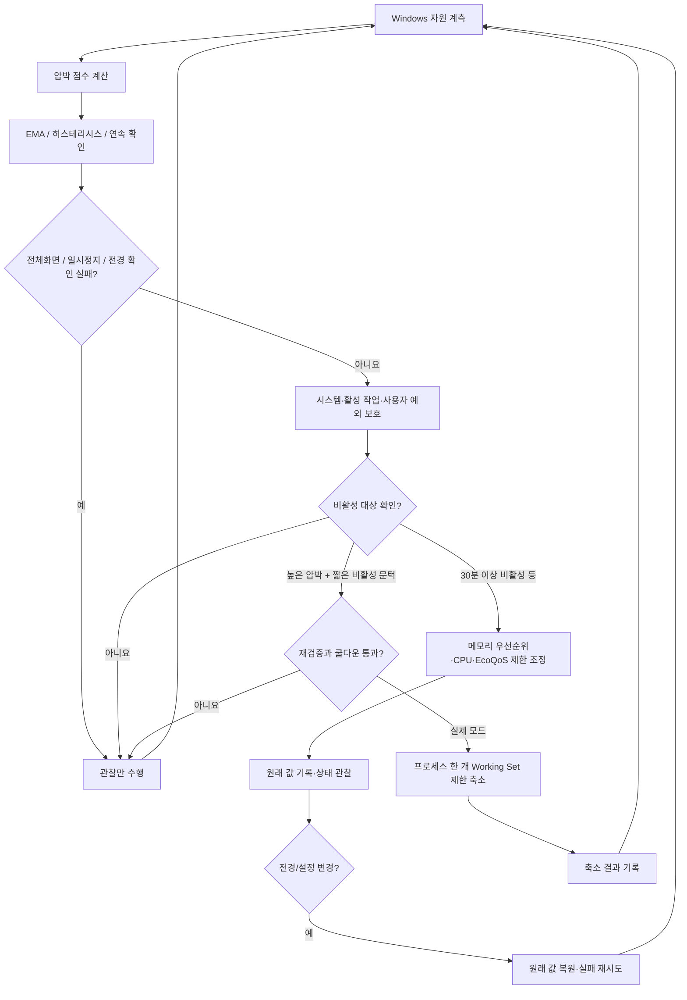
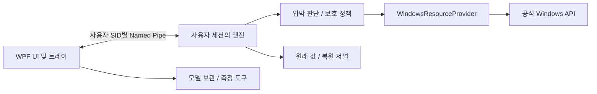

# RamFlow — 엔지니어링 사례 연구

> **주제:** 메모리가 제한된 Windows 환경에서 진행 중인 작업을 보호하는 자원 관리  
> **현행 구현:** v0.3.4 · C# / .NET 10 / WPF  
> **검증 범위:** 내부 테스트와 자체 프로그램 메모리 측정 기록 존재. 사용자 워크로드의 일반적인 성능 향상은 아직 입증되지 않음.

[English](ENGINEERING_CASE_STUDY.md) · [README](../README.ko.md) · [최신 아키텍처](NATIVE_ARCHITECTURE.md) · [검증 기록](VALIDATION.md) · [재현 실험 계획](MEASUREMENT_PROTOCOL.md)

## 1. 문제를 어떻게 정의했는가

RAM이 부족할 때 프로세스 종료나 캐시 비우기만 반복하면 일시적으로 사용 가능 메모리 수치가 늘 수 있지만, 중요한 작업이 중단되거나 다시 페이지를 읽어 오는 비용이 생길 수 있습니다.

RamFlow가 다루는 질문은 **“가장 많은 RAM을 확보하는 방법”이 아니라 “사용 중인 작업을 보호하면서 압박 상황에 제한적으로 반응할 수 있는가”**입니다.

설계에 둔 제약:
- 커널 드라이버·문서화되지 않은 후킹·자동 프로세스 종료·Standby List 일괄 비우기 사용 금지
- 활성 창, 동일 이름의 연관 프로세스, 보안·시스템 프로세스, 활발한 CPU/입출력 작업 보호
- 활동 상태·프로세스 신원이 불명확하면 조치하지 않는 보수적 기본값
- 되돌릴 수 있는 설정은 원래 값과 복원 기록을 먼저 저장
- 최적화 도구 자체의 메모리 소비도 측정 대상에 포함

## 2. 판단 흐름

위 도식은 주요 판단 순서를 요약한 것이며 전체 코드 분기를 그대로 복제한 그림은 아닙니다. 구현: [Policy.cs](../native/RamFlow.Core/Policy.cs), [Engine.cs](../native/RamFlow.Core/Engine.cs).

### 압박 판단

사용 가능 RAM, Commit 비율, 페이지 입력, 페이지파일 사용률, Standby 메모리 등을 휴리스틱으로 합쳐 압박을 추정합니다. 압박이 증가할 때 더 빠르게 반영하는 EMA와 연속 확인·히스테리시스를 사용하여 정책이 빈번하게 바뀌는 일을 억제합니다. 극심한 자원 부족에는 별도 위기 조건을 둡니다.

**트레이드오프:** 안정적인 판단을 위해 일부 반응을 늦춥니다. 모든 버벅임을 예측하거나 직접 해결한다고 주장하지 않습니다.

### 작업 보호와 제한적 조치

- CPU·메모리 우선순위/EcoQoS 조정은 **30분 이상 관측된 비활성 상태**와 별도 자원 조건이 있어야 가능합니다.
- Working Set 축소는 **High 이상 압박**, **150MiB 이상 프로세스**, 비활성 **High 10분 / Severe 3분 / Critical 1분** 문턱을 통과해야 합니다.
- 축소 시도는 **전체 120초**, **같은 PID 900초** 간격을 지키고, 한 번의 순회에서 최대 한 대상을 시도합니다.
- 조치 직전에 전경·전체화면·대상 신원을 다시 확인합니다. 기본값은 실제 설정을 바꾸지 않는 **Dry Run**입니다.
- 사용 예측 기능은 예정 작업의 보호에 사용하며 선제 축소 근거로 사용하지 않습니다.

**트레이드오프:** 일부 회수 가능한 메모리를 그대로 남기더라도 사용자 작업을 해칠 가능성을 줄입니다.

### 복원과 장애

우선순위 같은 되돌릴 수 있는 설정은 변경 전에 원래 값을 저널에 기록합니다. PID 재사용·프로세스 신원 확인 실패·부분 실패를 구분하고, 복원 실패 기록을 유지하여 재시도합니다. 전경으로 돌아온 앱은 별도의 빠른 확인 경로에서 복원을 요청합니다.

단, **Working Set 축소는 이전 바이트 수로 즉시 되돌릴 수 없습니다.** Windows가 필요 시 페이지를 다시 읽어옵니다. 강제 종료나 전원 손실 직후 즉시 복원할 수도 없으며, 다음 실행에서 저장된 복원 저널을 다시 처리하도록 설계했습니다.

## 3. 시스템 경계

- **프로세스 강제 종료·캐시 삭제** 대신 보호·제한적 조정을 선택했습니다.
- **고정 CPU affinity** 대신 복원 가능한 CPU Sets를 선택했고, 문서화된 API만 사용합니다.
- **WinUI 3 대신 WPF**를 택한 것은 배포 의존성과 구현 환경을 고려한 판단이지 성능 우월성 주장이 아닙니다.
- **클라우드 공간을 RAM으로 사용하는 기능은 없습니다.** 모델 보관은 파일 저장 기능이며 별도 검증·삭제 승인을 요구합니다.

## 4. 측정한 것과 측정하지 않은 것

저장소의 [검증 문서](VALIDATION.md)는 동일 PC에서 **실제 WPF 실행·9개 화면 순회를 3회 비교**했다고 기록하고 있습니다.

| RamFlow 프로세스 측정값 | v0.3.3 | v0.3.4 | 변화 |
| --- | ---: | ---: | ---: |
| 최대 상주 메모리 중앙값 | 347.6 MiB | 165.0 MiB | 약 **52.5% 감소** |
| 전용 메모리 중앙값 | 263.5 MiB | 80.6 MiB | 약 **69.4% 감소** |

기록된 변경 사항은 소프트웨어 렌더링, 사용하지 않는 계측의 지연 초기화, 아이콘 디코딩 제한입니다.

**주의:** 이는 *RamFlow 프로그램 자체의 메모리* 측정입니다. Windows 전체의 RAM 절약, 다른 앱의 응답 속도 향상, 실제 사용자 생산성 향상을 보여주는 데이터가 아닙니다. 현재 문서에는 개별 반복 측정 원본, 신뢰구간 및 독립 재현 기록이 없습니다.

## 5. 근거 자료

| 주제 | 소스·테스트 | 남은 불확실성 |
| --- | --- | --- |
| 압박 점수와 흔들림 방지 | [Policy.cs](../native/RamFlow.Core/Policy.cs) | 실제 응답성 개선 여부 |
| 보호 대상·조치 빈도 | [Engine.cs](../native/RamFlow.Core/Engine.cs) · [Mock 테스트](../native/RamFlow.Tests/Program.cs) | 모든 외부 앱의 안전성 |
| 원래 설정 복원 | [Engine.cs](../native/RamFlow.Core/Engine.cs) · [검증 기록](VALIDATION.md) | 강제 종료 직후 즉시 복원 |
| IPC 경계 | [EnginePipe.cs](../native/RamFlow.Core/EnginePipe.cs) | 전면적인 보안 감사 |
| UI 자체 메모리 감소 | [검증 기록](VALIDATION.md) | 시스템 전체 RAM·지연시간 개선 |
| 배포 빌드 | [Native CI](../.github/workflows/native.yml) | 이번 문서 변경에서 테스트 재실행 여부 |

테스트 코드와 자동화 워크플로가 존재하지만 **이번 문서 수정 과정에서 Windows 테스트를 새로 실행한 것은 아닙니다.**

## 6. 실패 가능성과 앞으로의 실험

| 위험 | 현행 대응 | 추가 검증 과제 |
| --- | --- | --- |
| 스캔 사이 전경 앱 변경 | 조치 직전 재검증·빠른 전경 복원 | 빠른 앱 전환 스트레스 테스트 |
| 활동 정보 부족 | 미확인 대상 보호 | 실제 오탐률 측정 |
| PID 재사용 | 프로세스 생성 신원 확인 | 절전·복귀 시나리오 검증 |
| 조치 일부만 성공 | 원래 값 저널·복원 재시도 | 권한·크래시 조합 실험 |
| Working Set 재접근으로 페이지 입력 증가 | 축소 빈도 제한 | 하드 폴트와 작업 지연 비교 |
| 없는 센서값 | 미지원으로 표시 | 하드웨어 지원 표 |

다음 목표는 같은 컴퓨터·같은 작업을 **RamFlow 미실행 / Dry Run / 실제 개입** 세 조건에서 여러 번 비교하는 것입니다. 확보된 RAM 수치만 보지 않고 작업 완료 시간, 전경 지연, 페이지 입력, 실패와 부작용까지 함께 기록해야 합니다. 구체적인 절차는 [재현 실험 계획](MEASUREMENT_PROTOCOL.md)에 있습니다.

---

**핵심 교훈:** 제한된 컴퓨터를 위한 최적화는 무조건 메모리를 많이 비우는 문제가 아니라, 현재 작업을 보호하면서 근거 있는 개입과 복원 정책을 설계하는 문제입니다. 지금 확인된 근거는 보수적인 설계와 프로그램 자체의 메모리 감소이지 Windows 전체의 성능 개선이 아닙니다.
