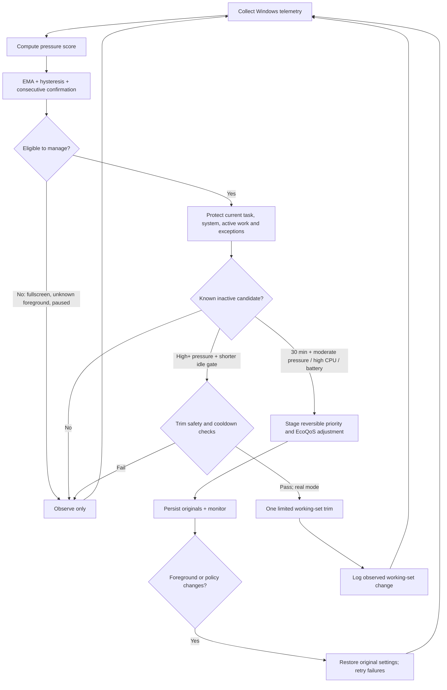
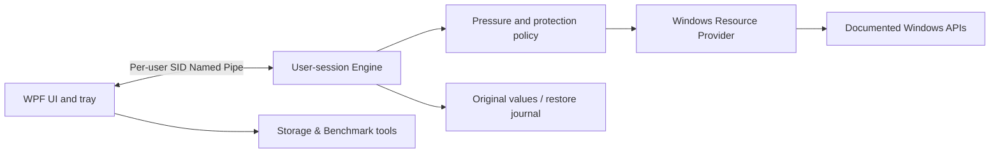

# RamFlow — Engineering Case Study

> **Scope:** Windows resource orchestration under constrained memory.  
> **Current implementation:** v0.3.4 · C# / .NET 10 / WPF.  
> **Status:** Published Windows release; algorithmic and safety tests exist. Real-world speedup across user workloads is **not yet established**.

[한국어 사례 연구](ENGINEERING_CASE_STUDY.ko.md) · [Main README](../README.md) · [Native architecture](NATIVE_ARCHITECTURE.md) · [Validation record](VALIDATION.md) · [Measurement protocol](MEASUREMENT_PROTOCOL.md)

## 1. The engineering problem

On a memory-constrained Windows PC, background workloads can compete with the application a person is actively using. Naively terminating processes or clearing caches can disrupt unsaved work or cause more paging when applications are reopened.

The engineering question is narrower than “How do we free the most RAM?”:

**Can a user-space tool respond to observable resource pressure while protecting ongoing work, constraining its interventions, and restoring reversible settings?**

### Design constraints

- No kernel drivers, undocumented process manipulation, standby-list clearing, or automatic process termination.
- Keep the foreground application, related task groups, active I/O/CPU work, and known critical/security processes protected.
- Fall back to *no action* when identity, ownership, sensor availability, or process activity is uncertain.
- Preserve reversible process settings across ordinary exit and interrupted sessions.
- Assume that the optimizer itself consumes scarce CPU and memory; measure its overhead.

## 2. Policy: observe → decide → intervene → restore

This is a *simplified decision model*, not a line-by-line diagram of every branch. The native implementation lives in [Policy.cs](../native/RamFlow.Core/Policy.cs) and [Engine.cs](../native/RamFlow.Core/Engine.cs).

### Pressure detection

`Pressure.Update` uses available memory, committed memory, page input, pagefile usage, and standby memory to calculate a bounded heuristic score. It smooths the score with an exponential moving average (faster upward than downward), then applies consecutive-sample confirmation and hysteresis to avoid rapid level changes. A severe condition can trigger an expedited critical classification.

**Trade-off:** smoothing reduces oscillation but also delays some interventions. Emergency thresholds provide a bounded exception; neither policy is a claim to predict every source of application stutter.

### Workload protection

`Policy.Protect` checks system/security process names, foreground PID/name, explicit exclusions, known activity, task groups and protected paths. `Engine.Tick` also accounts for sibling processes by executable name before deciding inactivity. A late validation checks foreground/fullscreen state again immediately before a trim.

**Trade-off:** name- and heuristic-based protection may miss a workload or conservatively protect an unrelated process. Unknown activity is treated as protected rather than risk an aggressive false positive.

### Bounded intervention

- Memory/CPU/EcoQoS priority changes require **30 minutes of observed inactivity**, an eligible workload and a pressure/CPU/battery condition.
- Working-set trims require at least **High** pressure, a candidate working set of at least **150 MiB**, inactivity of **10 minutes (High)**, **3 minutes (Severe)** or **1 minute (Critical)**, plus pre-action revalidation.
- Trim attempts are rate-limited to **one every 120 seconds globally** and **one every 900 seconds per PID**; only one candidate is attempted per scan.
- Dry Run is the default. Prediction is protection-oriented: it does not authorize preemptive trims.

**Trade-off:** the engine may leave reclaimable memory untouched. It prioritizes avoiding damage to interactive work over reporting a larger “RAM saved” figure.

### Restoration and failure containment

Before process priority changes, the engine records original values and, when persistence is enabled, writes a restore journal. It validates PID identity to avoid applying old settings to a different process after PID reuse. Settings changes, pause, foreground transitions and shutdown request restoration; failed restorations remain pending for retries.

A working-set trim **cannot be instantly undone** by setting the old byte count: Windows pages data back in as needed. Likewise, forced termination or power loss does not allow immediate restoration; a persisted journal supports recovery on a later launch.

See [Engine.cs](../native/RamFlow.Core/Engine.cs), [EnginePipe.cs](../native/RamFlow.Core/EnginePipe.cs) and [native architecture](NATIVE_ARCHITECTURE.md).

## 3. Architecture and why it matters

The UI and engine are separated so that resource observation and policy do not have to live inside a heavy page-rendering process. IPC is scoped to the user's session, rejects remote connections, and applies message-size and permission checks. Optional SCM monitoring runs separately from foreground-aware interventions.

Alternatives considered by the implementation:
- **Aggressive process kill / cache clearing:** rejected because freed memory is a misleading proxy for responsiveness and can lose work or increase reload cost.
- **Permanent affinity / undocumented priority APIs:** avoided in favor of supported, reversible CPU Sets and documented priority/EcoQoS operations.
- **WinUI 3:** WPF was selected for the native implementation to limit packaging/runtime complexity in the target environment; this is a deployment trade-off, not a general performance superiority claim.
- **Cloud as RAM:** rejected. Model archiving is file storage with verification and explicit deletion, never virtual memory.

## 4. Measured result: reduce the optimizer's own cost

The existing [validation record](VALIDATION.md) reports **three runs of launching the real WPF app and navigating nine pages** on the author's computer, comparing v0.3.3 and v0.3.4. The documented measurements are medians:

| RamFlow process measurement | v0.3.3 | v0.3.4 | Relative difference |
| --- | ---: | ---: | ---: |
| Peak resident / working-set memory | 347.6 MiB | 165.0 MiB | about **52.5% lower** |
| Private memory | 263.5 MiB | 80.6 MiB | about **69.4% lower** |

The recorded optimization choices were process-level software rendering, delaying unused instrumentation initialization, and limiting icon decoding. These figures are specific to **RamFlow's own process and this test procedure**. They do **not** measure total system RAM saved, application latency, background-page faults, user productivity or causality in a randomized experiment.

**Evidence quality:** the repository includes this summary but not raw per-run samples, hardware specification, a paired experiment log or confidence intervals. This is a documented internal measurement, **not an independently reproduced benchmark**.

## 5. Evidence map: claims and code

| Engineering claim | Implementation or verification artifact | What it does *not* prove |
| --- | --- | --- |
| Pressure smoothing and classification | [Policy.cs](../native/RamFlow.Core/Policy.cs) | End-to-end real-world responsiveness |
| Foreground/active-work protection and cooldowns | [Engine.cs](../native/RamFlow.Core/Engine.cs), [native mock tests](../native/RamFlow.Tests/Program.cs) | Every third-party app is always safe |
| Persisted originals and guarded restore | [Engine.cs](../native/RamFlow.Core/Engine.cs), [validation notes](VALIDATION.md) | Immediate recovery after power loss |
| Per-user bounded IPC | [EnginePipe.cs](../native/RamFlow.Core/EnginePipe.cs), [Windows/IPC test entry](../native/RamFlow.Tests/Program.cs) | Complete security audit |
| Separate UI/native packaging | [native architecture](NATIVE_ARCHITECTURE.md), [native workflow](../.github/workflows/native.yml) | Latest pipeline passed on this particular edit |
| Process footprint comparison | [VALIDATION.md](VALIDATION.md) | System-wide performance gain |

The source contains mock-based regression cases and Windows-only self-tests. Their existence is not a claim that those tests were executed as part of this documentation update.

## 6. Failure modes and open questions

| Failure or limitation | Existing mitigation | Work remaining |
| --- | --- | --- |
| Foreground app becomes active between scans | Recheck before trim; foreground restore loop | Test rapid app-switch stress with traces |
| System reports insufficient process activity metadata | Treat unknown activity as protected | Quantify false-positive/false-negative rate |
| PID gets reused | Check process identity before change/restore | Broader suspend/resume stress coverage |
| Partial write or failed restore | Journal originals and retry pending restoration | Test forced crashes under varied privileges |
| Working-set shrink causes later page-in | Short/rare trims; no automatic process termination | Measure page faults and time-to-interaction |
| Missing GPU/thermal telemetry | Mark unsupported; do not invent values | Hardware coverage matrix |
| Apparent memory gain without real user benefit | Explicitly separate memory counters from latency | Controlled A/B user-workload benchmark |

## 7. Next experiment: prove or disprove usefulness

A stronger result needs the same reproducible workload under three conditions: **no RamFlow**, **RamFlow Dry Run** and **RamFlow intervention enabled**. Keep test order balanced; repeat each condition on the same hardware. Capture foreground action latency, page-in/out, committed memory, CPU, application start/ready timing and RamFlow overhead; report failed tasks and adverse effects, not just favorable numbers.

Do not apply real interventions to unsaved work. The step-by-step plan and unfilled reporting template are in [MEASUREMENT_PROTOCOL.md](MEASUREMENT_PROTOCOL.md).

---

**Portfolio lesson:** resource optimization is a constraint-management and recovery problem, not a competition to display the largest free-RAM number. The current evidence supports a guarded design and a smaller application footprint; it does not yet establish a general improvement in Windows performance.
