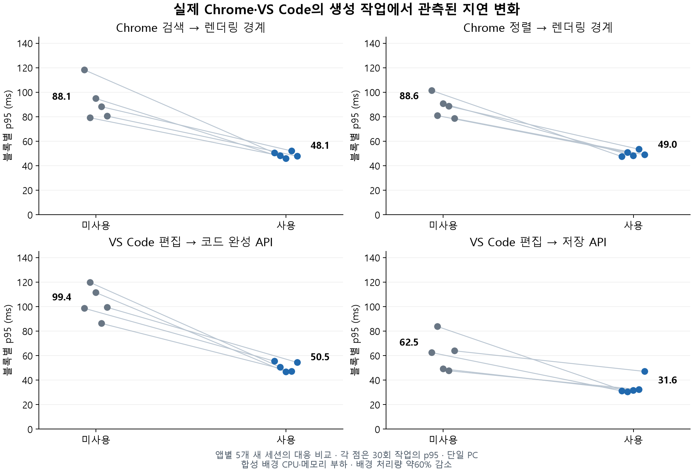

# Chrome·VS Code 실제 앱 재현 작업 검증 — 2026-11-10

**이 PC의 통제된 메모리·CPU 경쟁 조건에서 Chrome과 VS Code의 테스트 작업 모두 지연이 줄었습니다.** 각 기능5개 대응 블록 모두 개선됐습니다. 배경 처리량은 약60% 줄었습니다.

## 결과

각 조건에서 기능별30회 측정한 p95를 먼저 계산하고, 아래는 **5개 새 앱 세션의 블록별 p95 중앙값**입니다. 요청들을 독립된300회 실험으로 취급하지 않았습니다.

| 실제 앱의 재현 작업 | 미사용 | 사용 | 지연 감소 | 개선된 대응 블록 |
| --- | ---: | ---: | ---: | ---: |
| Chrome 검색 입력 → 렌더링 경계 | 88.15ms | 48.14ms | 45.4% | 5/5 |
| Chrome 정렬 클릭 → 렌더링 경계 | 88.56ms | 48.95ms | 44.7% | 5/5 |
| VS Code 편집 → TypeScript 코드 완성 | 99.36ms | 50.52ms | 49.2% | 5/5 |
| VS Code 편집 → 저장 | 62.46ms | 31.60ms | 49.4% | 5/5 |

## 자원을 양보한 비용

| 전경 앱 | 미사용 배경 처리량/초 | 사용 배경 처리량/초 | 감소 |
| --- | ---: | ---: | ---: |
| Chrome | 267,405 | 107,056 | 60.0% |
| VS Code | 220,064 | 87,371 | 60.3% |

배경 처리량 단위는 자체 부하 앱이 처리한64KiB SHA-256 조각 수/초의 근사값입니다. 전경 작업 구간 전후의 누적 진행량으로 계산했습니다. 전경 응답을 위해 지정한 배경 작업이 양보한 결과이며, 총 처리량 증가나 배경 작업 완료 시간의 같은 비율 변화로 해석하지 않습니다.

## 앱과 워크로드

- Chrome156.0.8078.49를 별도 사용자 데이터 디렉터리로 실제 실행했습니다. 로컬 대시보드는20,000개 레코드에서 그룹 검색 후1,000개 DOM 행을 다시 만들고 점수 순으로 정렬합니다. 입력은 Chrome DevTools Protocol의 신뢰된 입력/클릭 이벤트이며 모든 결과의 건수·첫/마지막 ID를 독립 계산과 대조했습니다. **일반 웹사이트를 직접 이용한 측정이 아닌, 실제 Chrome에서 실행한 생성 UI 작업**입니다.
- Chrome 주 지표는 클라이언트가 입력을 전달하기 시작한 시점부터 두 번째 requestAnimationFrame 경계를 관측할 때까지의 왕복 시간입니다. 자동화 통신·관측 오버헤드를 포함합니다. 두 번째 rAF는 렌더링 기회 경계이며 물리 화면 표시 완료를 보장하지 않습니다. JS 입력 이벤트→rAF와 스크립트 시간도 원본에 별도 보존했습니다.
- VS Code1.140.0을 별도 사용자 데이터·확장 디렉터리의 Extension Development Host로 실제 실행했습니다. 내장 TypeScript 기능을 사용해5,000개 데이터 행이 있는 생성 문서의 멤버 접근을 편집하고 코드 완성을 요청한 뒤, 유효한 코드로 다시 편집·저장했습니다. 각 코드 완성은 id/label/score/group을 모두 포함해야 하고 디스크와 편집기 내용이 일치해야 합니다.
- VS Code 시간은 실제 VS Code API의 편집→코드 완성 promise 완료, 편집→저장 완료입니다. 물리 키 입력→추천 창 표시 시간, 편집 화면의 실제 프레임 지연, 언어 서버 전체 진단 완료, 저장 매체의 물리적 fsync 시간을 측정한 것은 아닙니다.
- 개인 브라우저 세션·계정·확장과 개인 코드/설정은 사용하지 않았습니다. 파일은 모두 이 저장소의 테스트 폴더에서 생성했습니다. 외부 사이트의 네트워크 응답 시간도 포함하지 않았습니다.

## 비교 설계와 실제 제어

- 앱별5개 새 세션에서 미사용/사용을 교차 비교했습니다. 순서는 AB3개/BA2개를 시드20261110으로 섞었습니다. 같은 대응 블록에서는 같은 앱 인스턴스·배경 PID·외부 메모리 할당량을 유지했습니다.
- 미사용에는 최적화 엔진/트레이가 없고, 사용에는 측정된 실제 Core와 배포 트레이가 있습니다. 엔진은 테스트 호스트에서 실행하되 Windows 센서·정책·setter·전경 확인·원복은 실제 동작합니다. 변경 허용 대상은 생성한8개 배경 PID와 생성 신원뿐입니다. Chrome·VS Code 프로세스는 변경하지 않았습니다.
- 전경 PID는 안정화 구간의 샘플과 각 작업 배치 전후에 확인했습니다. 모든 순간의 물리 입력·화면을 연속 감시한 측정은 아닙니다.
- 배경 부하는 이전 실험과 같은 자체 부하 프로세스8개·각2스레드·64MiB입니다. **배경 작업은 실제 빌드·다운로드·AI가 아닌 합성 부하**입니다. 앱 전환 가능성을 확인하려고 전경 작업만 실제 앱으로 바꿨습니다. 이 비교에서는 큐 직렬화나 Working Set 강제 축소를 사용하지 않았습니다.
- 각 대응 블록 준비 때 가용 RAM 약768MiB를 목표로 외부 메모리를 할당한 뒤 고정하고2초마다 페이지를 읽었습니다. 조건별 재조정으로 프로그램 자체 비용을 상쇄하지 않았습니다. Windows의 자연 회수에 따른 실제 여유 변화는 그대로 기록했습니다.
- 할당 전 Commit1GiB를 예약했고, Commit90% 초과 또는 가용 RAM128MiB 미만2초 지속 시 부하를 해제하도록 했습니다. 이번 본 실험의 안전 해제는0회입니다.
- 초기 앱 실행·언어 서버 준비는 별도 무부하 preflight에 보존했습니다. 본 수치는 시작/콜드 인덱싱을 제외한 준비된 상태의 작업입니다. 각 조건은12초 안정화,5회 미보고 워밍업,문서/화면 초기화,1초 대기 뒤30회씩 측정했습니다.

| 앱 | 작업 직전 가용 RAM 범위 | 사용 조건의 실제 조정 | 원복 |
| --- | ---: | ---: | --- |
| Chrome | 642.5–984.0MiB | 매회8건 | 모두 최초 값과 일치 |
| VS Code | 1012.9–1295.1MiB | 매회8건 | 모두 최초 값과 일치 |

## 반복별 결과와 관측 오버헤드

| 기능 | 블록별 p95 감소(%) |
| --- | --- |
| Chrome 검색 입력 → 렌더링 경계 | 57.32, 39.16, 51.66, 40.95, 40.63 |
| Chrome 정렬 클릭 → 렌더링 경계 | 53.18, 37.19, 46.91, 39.65, 37.68 |
| VS Code 편집 → TypeScript 코드 완성 | 43.75, 57.80, 58.06, 45.38, 45.22 |
| VS Code 편집 → 저장 | 50.15, 63.68, 35.78, 32.21, 26.30 |

Chrome 내부 JS 이벤트→두 번째 rAF 경계의 블록별 p95 중앙값도 다음과 같이 기록했습니다. 자동화 왕복 지연과 구분합니다.

| Chrome 내부 지표 | 미사용 | 사용 |
| --- | ---: | ---: |
| 검색 이벤트→rAF | 72.70ms | 44.40ms |
| 정렬 이벤트→rAF | 83.00ms | 46.90ms |

## 무결성과 자료

- 본 실험20개 조건, 총1,200개 기능 작업을 완료했습니다. 모든 검색/정렬 조작이 건수·첫/마지막 행 검증을 통과했고, 모든 코드 완성에 예상 필드가 있었습니다. VS Code의 대응 쌍별 최종 저장 해시도 일치했습니다. 각 사용 조건의 실제 자원 조정과 최초 값으로의 원복을 확인했습니다. 대상 밖 변경 요청0회, 안전 부하 해제0회입니다.
- 앱별 실행 파일 해시가 측정 전후 일치했고 관측한 앱 버전도 모두 같았습니다. Core는 기존 테스트 ZIP과 같은 `d64160b80aa90ad478ce83599386dd82e22ecce3304955dedba36e261bb38b93`입니다. 이번 검증을 위해 제품의 정책이나 실행 파일을 바꾸지 않았습니다.
- [40개 기능별 요약 CSV](evidence/2026-11-10-real-apps/trials.csv) · [프로토콜·전체 요약 JSON](evidence/2026-11-10-real-apps/summary.json). 로컬 `benchmarks/2026-11-10-real-apps/`에는 각 작업 원본, 센서, 이벤트, 고정된 실행 소스와 완주 기록이 있습니다. 무부하 preflight와 테스트 전용 앱 프로필은 `.test-data/real-app-study/`에 별도 보존했습니다.
- Chrome 제어/격리는 [Chrome 공식 문서](https://developer.chrome.com/blog/remote-debugging-port), VS Code의 별도 개발 호스트는 [공식 통합 테스트 문서](https://code.visualstudio.com/api/working-with-extensions/testing-extension), 언어 기능 요청은 [공식 내장 명령](https://code.visualstudio.com/api/references/commands)을 참고했습니다. 앱 실행과 결과 검증은 실제 설치 버전으로 확인했습니다.

## 해석

앞선 SHA-256 전경 작업만의 결과에 더해, **실제 Chrome 렌더러와 VS Code의 내장 편집 기능에서도 이 통제 부하에서는 개선이 관측됐습니다.** 전경 응답과 배경 진행량의 교환 관계가 핵심이며, RAM 우선순위만의 독립 효과나 전체 처리량 향상을 입증한 것은 아닙니다.

한 PC·앱별5개 재현 세션의 기술 검증입니다. 테스트 앱·부하는 종료했고 개인 앱의 우선순위나 설정은 바꾸지 않았습니다.
