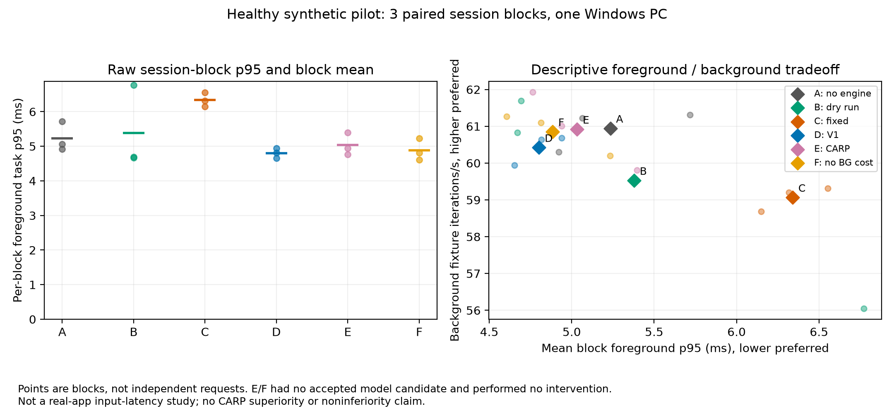

# 추가 구현과 실측 결과 — 2026-11-10

기존 `research/carp`에서 이어서 실측 모델·Windows 실행기·starvation·소거·독립 관측·자동 분석을 개발했다. 연구 빌드는 `0.4.0-carp.2`, 정책은 `0.2.0-research`다. **CARP가 V1/고정 정책보다 우수하다는 결론은 보류한다.**

## 실제 수행

- 초기 프로세스 내 관측 구성 24시행과 독립 관측 구성 24시행은 분리 보존한다. 두 버전을 합쳐 표본수를 늘리지 않는다.
- 최종 보정 자료는 건강 상태 fit 3·validation 3 대응 세션 블록, 무개입/CPU/CPU+EcoQoS/메모리 우선순위 24시행이다. 모두 완료·원복했다.
- 동결 모델 후보 3개는 validation 특징 지원 범위 조건으로 모두 거부됐다. 예측 가능한 일부 행의 MAE가 작더라도 전체 지원 조건 실패를 무시하지 않았다. 예측 불가능한 행은 null이다.
- 건강 상태에서 A–F × 3 대응 블록 = 18시행을 실제로 수행했고 18개 모두 정확성·원복 검사를 통과했다. C만 총3회 개입했고 A/B/D/E/F는 무개입이었다. F는 배경 비용 제거 프로필 하나만 실측했다. 다른 다섯 소거 프로필은 기능 시험만 수행했다.
- 전 코어 CPU 예비 시도는 제한 시간 내 요청 수 확보 실패 3건, 다음 시행 준비 중 중단 1건, 미시작14건으로 끝났다. 유효한 CPU 비용 모델·효능 결과로 채택하지 않았다. 생성한 호스트만 신원 확인 후 중단했으며 관련 자식 생성 신원이 남지 않았음을 확인했다.
- RAM·혼합 압박, Chrome·VS Code·실제 빌드, 다른 물리 PC는 이번에 실측하지 않았다.

## 건강 상태의 기술통계

전경 역할은 OS 포커스 창이 아닌 자체 SHA/page-walk 작업이다. 각 값은 **세션 블록 요약의 평균**이며 요청들을 독립 반복으로 계산하지 않았다. 단위 반복은 정해진 배경 fixture 연산 1회다. 숫자 차이를 알고리즘 효과나 통계적 우위로 해석하지 않는다.

| 조건 | 블록 수 | 전경 p50 (ms) | 전경 p95 (ms) | 배경 반복/초 |
|---|---:|---:|---:|---:|
| A | 3 | 4.225 | 5.234 | 60.945 |
| B | 3 | 4.274 | 5.378 | 59.526 |
| C | 3 | 4.437 | 6.340 | 59.066 |
| D | 3 | 4.250 | 4.802 | 60.421 |
| E | 3 | 4.243 | 5.032 | 60.918 |
| F | 3 | 4.267 | 4.884 | 60.853 |

E/F의 모델은 채택 후보가 없어 실제 제어를 하지 않았다. 따라서 E/F가 A/D와 비슷하거나 C보다 나아 보이는 숫자를 CARP의 효과라고 부를 수 없다. 같은 응답성을 유지하면서 배경 처리량을 더 보존한다는 확증 판단도 하지 않는다. 95% 대응 블록 bootstrap CI·효과 크기·Pareto·소거/실패 표는 CSV/자동 분석에 있으나 n=3의 탐색 자료이며 동시 CI·유의성·동등성 보장이 아니다. p99에 필요한 요청 수와 완료시간 자료는 부족하다. 기본 배경은 연속 부하라 완료시간은 해당 없음이다.

## 실제 관측한 비용

CPU는 전체 논리 CPU 기준 %, 메모리는 MiB다. 엔진-호스트는 엔진과 오케스트레이션/컨트롤러를 포함한다. idle은 엔진 생성 전 호스트 참조, observe는 센서 준비, evaluate는 거부/판단, intervene은 C의 실제 개입, restore는 원복 구간이다. 이것을 배포 제품 전체 idle 또는 순수 엔진 비용으로 바꾸지 않는다. 짧은 구간의 0%는 계수 정밀도/샘플 수의 한계이며 비용이 없다는 보장이 아니다.

| 조건·역할·상태 | CPU % | Private MiB | Working Set MiB | 결정 호출 ms | 로그 쓰기 호출 ms |
|---|---:|---:|---:|---:|---:|
| E · engine-host · idle | 2.411 | 19.758 | 50.477 | 미측정 | 미측정 |
| E · engine-host · observe | 0.000 | 21.475 | 53.764 | 미측정 | 미측정 |
| E · engine-host · evaluate | 2.773 | 24.894 | 60.815 | 4.115 | 2.998 |
| C · engine-host · intervene | 2.078 | 22.856 | 58.347 | 0.006 | 0.980 |
| E · engine-host · restore | 0.000 | 26.306 | 63.460 | 0.072 | 0.147 |
| E · observer · evaluate | 1.086 | 9.906 | 34.517 | 미측정 | 미측정 |

정책/로그 호출의 시간은 계측한 실제 호출 벽시계이며 디스크 영구 기록 latency 보장이 아니다. 첫 JIT·초기화가 짧은 창에 포함될 수 있다. 트레이/선택 서비스는 띄우지 않았으므로 미측정이며 0으로 표기하지 않았다. 이전 C#/Python 버전 대비 개선을 주장하지 않는다.

## 새 기능 검증과 남은 일

네이티브 Windows/IPC 포함 로컬 **506 assertion 통과**. 분석 21 tests, 기존 관찰기 38 tests, 스케줄 28 tests, 실행기 설정 2 tests, 실제 disposable Windows 실행기 통합 및 기존 재생 검사로 확인한다. 최종 원격 CI는 PR의 해당 commit 검사 기록을 따른다.

기아 가드는 실제 진행 정체, 기준 처리율이 있을 때 심한 저하, 관측 불가의 최대 제한 시간, 단계 완화·복구 창을 다룬다. 120초는 정책 복원 요청 시한이며 OS 복구 성공 보장이 아니다. 여섯 소거 프로필은 필수 안전장치를 제거하지 않는다. 메모리 인식 소거의 현재 조작은 메모리 후보 억제이고 경합 분류기 자체의 기여를 분리 입증한 실험은 아니다.

본실험 전에는 독립 모델 보정과 OOD 지원 범위 확보, 실제 앱/유한 배경 작업 어댑터, CPU/RAM/혼합 조건의 안정적 획득, 8/16/24+ GiB PC 반복, 충분한 warmup·관찰 창·제어/기아 기간, 전체 제품 오버헤드, 사전 고정 분석 계획과 독립 재현이 필요하다. 이번 개발 중 dirty 바이너리에서 수집한 자료를 최종 커밋 또는 공개 배포본의 성능으로 재표기하지 않는다.

[실측 모델](MEASURED_MODEL.ko.md) · [실행 명령·제약](RESEARCHLAB.ko.md) · [소거/기아 방지](STARVATION_ABLATIONS.ko.md) · [새 선행연구](RELATED_WORK_UPDATE.ko.md) · [요약 JSON](evidence/2026-11-10-phase2/summary.json)
