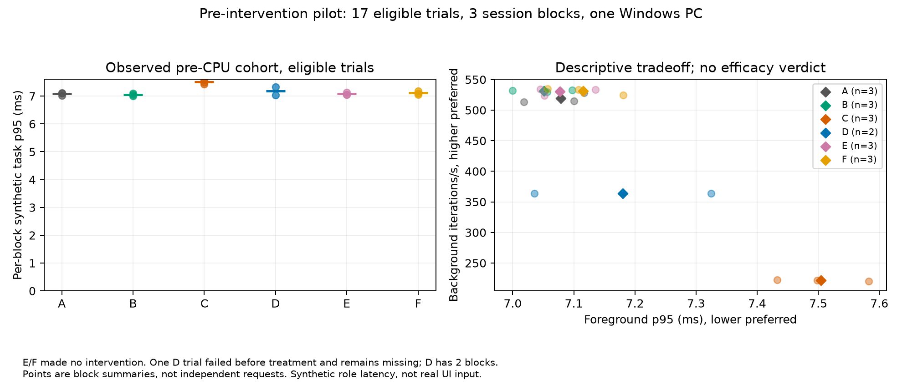

# 조치 전 기준 수정 후 CPU 재실험 — 2026-11-10

**학습·비교의 사후 상태 선택 문제를 수정했고, 새 파일럿에서 후보2개의 예측 검증이 통과했다. CARP의 성능 우위는 입증되지 않았다.**

측정은 `9b4c163`의 clean 소스와 같은 바이너리로 수행했다. 기본5초 조치 전 창과 센서 중앙값으로 경합/특징을 고정한 후 Engine을 생성했다. 조치 후 상태 전환은 결과로 보존한다. 새 workload v2·outcome schema3을 사용하며 이전 자료를 재라벨링하거나 합산하지 않는다.

- 보정6·validation3 블록 × 무개입/CPU/CPU+EcoQoS =27시행 완료·원복. 각 후보의 검증3블록은 fit에서 분리했고 모델 반경/오차/품질 기준을 완화하지 않았다.
- 별도 seed A–F ×3블록=18시행 중17개 유효,1개 실패,18개 모두 원복·범위 밖 요청0. C3개는 조치 후 healthy로 전환해도 CPU 코호트에 유지됐고 D2개도 상태 변동만으로 제외되지 않았다.
- D1개는 조치 전에 관측기 phase 파일 교체 AccessDenied로 실패했다. 원본은 보존했고 대응 블록에 다른 시행을 대입하지 않았다.
- 측정 중 로컬 테스트/빌드/분석은 실행하지 않았다. 부모는 완료 파일 수 확인과 진행 안내만 수행했다. 사용자 장비의 다른 활동이 없었다고 보증하지 않는다.

| 후보 | 채택 | 검증 블록 | 전경 이득 MAE | 배경 손실 MAE | 재접근 위험 MAE | 품질 |
|---|---:|---:|---:|---:|---:|---:|
| LowerCpu | 예 | 3 | 0.00768 | 0.00376 | 0.09428 | 0.83699 |
| LowerCpu, EcoQos | 예 | 3 | 0.00951 | 0.00298 | 0.03032 | 0.94182 |

MAE는 정규화 상대 효과의 절대 오차이며 ms가 아니다. 품질은 경험적 잔차에서 만든 휴리스틱이고 성공 확률/통계적 신뢰구간이 아니다.

| 조건 | 유효 블록 | p50 ms | p95 ms | 배경 반복/초 | 적용 횟수 |
|---|---:|---:|---:|---:|---:|
| A | 3 | 6.668 | 7.079 | 519.024 | 0 |
| B | 3 | 6.704 | 7.051 | 531.346 | 0 |
| C | 3 | 5.855 | 7.505 | 221.520 | 3 |
| D | 2 | 5.989 | 7.180 | 364.138 | 8 |
| E | 3 | 6.732 | 7.077 | 530.443 | 0 |
| F | 3 | 6.774 | 7.115 | 530.934 | 0 |

값은 유효 세션 블록 요약의 동일 가중 평균이다. D는2블록이므로 표의 평균끼리 차감하는 대신 대응 블록의 자동 대비를 사용해야 한다. p99와 유한 작업 완료시간은 확보하지 못했다.

E/F는 검증된 후보를 받았지만 보수적 전경 이득이 비용·진입 여유를 넘지 않아 무개입을 선택했다(`no-net-benefit-above-margin`). E의 값은 무개입 A와 비슷한 수준이며 E가 실제 개입해 성능을 개선했다는 근거가 아니다. C의 배경 손실이 커 보이더라도 CARP가 Windows 기본 상태보다 우수하다거나 동등성을 입증한 것은 아니다. 이 자료는 불필요한 제한을 피하는 동작과 예측 경로의 탐색 검증이다.

대응 블록 bootstrap95% CI·효과 크기·Pareto·실패·소거·오버헤드 표는 evidence에 보존했다. n=3(D 대비2)의 짧은 단일 PC 파일럿이며 유의성/동등성/본실험 성공 판단을 하지 않는다. F는 배경 비용 제거 하나뿐이고 E/F 모두 무개입이라 해당 구성 요소의 효능 기여도 입증하지 못했다.

관측기 오류는 delete sharing을 막는 읽기 핸들로 재현해 제한된 재시도로 보완했다. 영구 오류·이전 파일 보존 검사를 통과했다. 이후 `91c2575`에서 별도 V1 기능 시행1회가 CPU 압박에서 완료·원복됐고4회 적용을 확인했다. 이 시행은 실패한 원래 D의 대체 블록이 아니며 효능 통계에 포함하지 않았다. 원래45회 자료를 새 관측기 바이너리의 성능으로 바꾸지 않는다.

남은 검증은 실제 CARP 개입이 유익한 경쟁 상황, 새로운 독립 반복, 긴 관찰/기아 기간, Chrome·VS Code·빌드/유한 완료시간, RAM/혼합 압박과 여러 물리 PC, 전체 제품 오버헤드·여섯 실측 소거 및 사전 고정 본실험이다. 현재 결과로 KCI 게재나 CARP 우위를 보장하지 않는다.

코드 검증: 조치 전 수정은 Windows/IPC514 assertion, 관측기 보완 후518 assertion을 통과했다(합산하지 않음). 분석24·실행기3·스케줄28 검사와 disposable Windows 통합도 통과했다. 최종 CI 상태는 PR의 최종 commit 검사로 확인한다.

